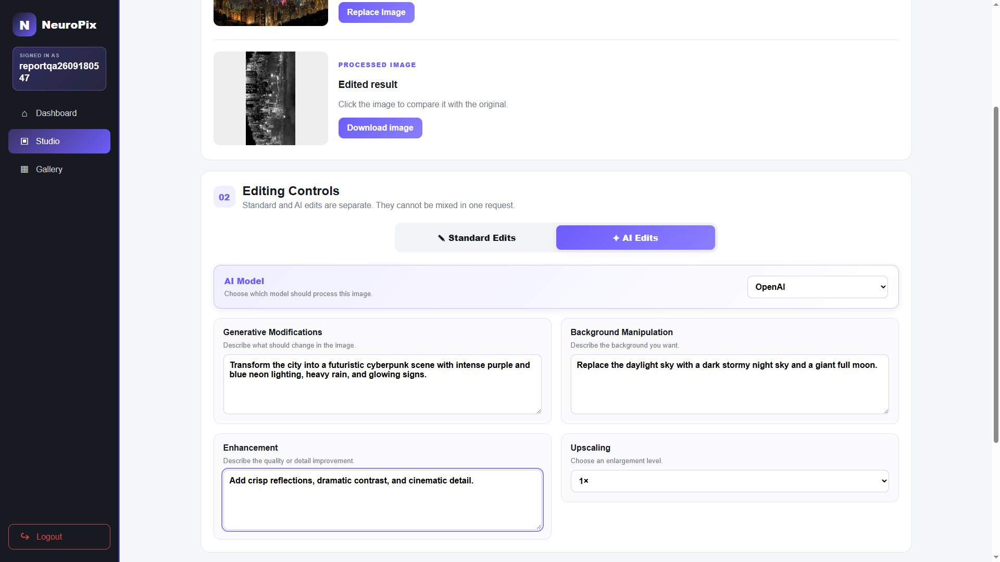
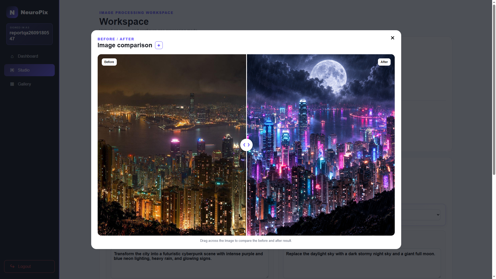
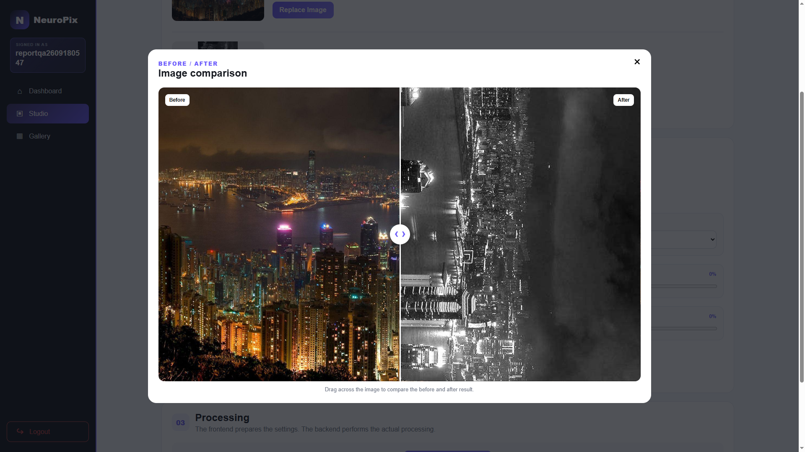

# NeuroPix

NeuroPix is a completed software engineering senior project: a browser-based image editor with standard controls and AI-assisted edits. Users upload a JPG or PNG, choose an editing mode, compare the result with the original, and save both versions for later use.

The application supports OpenAI image editing and an optional local Stable Diffusion service. MySQL stores accounts and image metadata; Amazon S3 stores the image files.

This repository contains the code, screenshots, and project documents. The university demo used temporary AWS hosting, so the website may become unavailable when that hosting ends. The screenshots below are stored in the repository and do not depend on the live site.

## See the application

These website screenshots were captured during project testing with a synthetic city-skyline image and a test account.

### AI editing controls



Users enter separate instructions for content, background, and image quality. For OpenAI, the backend adds a shared pre-prompt and field-specific rules. The local model receives the user's text without those OpenAI rules.

### OpenAI result



The comparison slider shows the original beside the result. This recorded request changed the skyline to a neon-lit night scene with rain and a moon.

### Standard editing result



Standard edits use Pillow rather than an AI provider. This example shows a rotated grayscale result.

## What it does

- Register and sign in, then upload JPG or PNG images to the Studio.
- Apply crop, rotation, brightness, exposure, contrast, saturation, blur, sharpness, and grayscale controls.
- Choose OpenAI or the optional local Stable Diffusion model for AI editing.
- Compare the original and result, download images, and reload a saved version for another edit.
- View saved images in the Gallery, download either version, or delete a saved image pair.

## Team and responsibilities

| Team member | Main responsibilities |
|---|---|
| [Abdulrahman Alguydi](https://github.com/AbdulrahmanAlguydi) | Project leadership and documentation, database and S3 storage, AI-provider integration, local-model setup, and deployment. |
| [Mohammed Dafterdar](https://github.com/M123731) | Frontend pages and styling, editing controls, browser-side interactions, image comparison, and Gallery interface. |
| [Saud Al-mansour](https://github.com/Artig3nce) | Flask backend and API routes, authentication, upload validation, standard image processing with Pillow, connecting the interface to backend services, and backend tests. |

These describe the main areas of responsibility. Integration and later revisions involved shared work across those areas.

### Abdulrahman's contributions

I led the project and handled its documentation and presentation preparation. I organized the work, tracked teammates' deadlines, arranged meetings, and produced the final report, presentation, and individual speaking scripts. I also coordinated in-person rehearsal reservations with other teams and gathered feedback before the presentation.

My technical work covered the MySQL schema and queries, image storage in S3, and the connection between stored files and database records. I also worked on the OpenAI integration and pre-prompt rules, the local Stable Diffusion service and reverse SSH connection, and the AWS deployment workflow. The relevant code is in [database](database/), [S3 helpers](utils/s3.py), [image storage service](services/image_service.py), [AI editing service](services/ai_editor.py), [local model](local_model/), and [deployment workflow](.github/workflows/deploy.yml).

NeuroPix was a team project. The frontend, Flask routes, standard image processing, Jinja pages, and Gallery include teammates' work and shared revisions. We used AI coding and writing tools during development and documentation; the commit history includes those assisted revisions as well as individual contributions.

## Stack and data flow

| Part | Implementation |
|---|---|
| Web application | Python, Flask, Jinja, HTML, CSS, JavaScript |
| Standard processing | Pillow |
| Accounts and metadata | MySQL, hosted on Amazon RDS for the demo |
| Image storage | Amazon S3 through boto3 |
| Hosted AI editing | OpenAI image-editing API |
| Optional local AI | Stable Diffusion 1.5, Diffusers, PyTorch, LitServe, Docker |
| Demo deployment | Amazon EC2, Nginx, Certbot, systemd, GitHub Actions |

Flask stages an upload in a temporary directory, runs the selected editor, uploads the original and result to S3, and saves their object keys with the user's image record in MySQL. The browser uses returned image URLs for previews and comparison. Database queries filter saved records by the signed-in user's ID.

For the deployed local-model path, a team member's Windows GPU computer opened a reverse SSH tunnel to EC2. Flask sent requests through the EC2 loopback endpoint to the Docker model service. The project uses a pretrained model; it does not train Stable Diffusion.

## Run locally

You need Python 3.9 or newer, MySQL, and your own S3 bucket and credentials. OpenAI editing also needs an API key with access to a supported image-editing model. Standard edits do not need OpenAI, but saving processed images still needs MySQL and S3.

### 1. Install dependencies

From PowerShell:

```powershell
git clone https://github.com/AbdulrahmanAlguydi/NeuroPix.git
cd NeuroPix
python -m venv .venv
.\.venv\Scripts\Activate.ps1
python -m pip install -r requirements.txt
Copy-Item .env.example .env
```

On macOS or Linux, activate the environment with `source .venv/bin/activate` and copy the template with `cp .env.example .env`.

### 2. Create the database

Open the MySQL client from the repository root:

```text
mysql -u root -p
```

Then run this inside MySQL:

```sql
SOURCE database/schema.sql;
```

The schema creates `neuropix_db` with `Users` and `Images` tables. It uses `CREATE ... IF NOT EXISTS` and does not delete an existing database.

### 3. Configure your services

Edit `.env` with your own values:

| Variables | Purpose |
|---|---|
| `DB_HOST`, `DB_PORT`, `DB_USER`, `DB_PASSWORD`, `DB_NAME` | MySQL connection |
| `AWS_ACCESS_KEY_ID`, `AWS_SECRET_ACCESS_KEY`, `AWS_BUCKET_NAME`, `AWS_REGION` | S3 access |
| `SECRET_KEY` | A long, random Flask session-signing key |
| `OPENAI_API_KEY`, `OPENAI_IMAGE_MODEL` | OpenAI credentials and an image-editing model available to your account |
| `LOCAL_MODEL_URL` | Optional local model's `/predict` endpoint |

The example file contains placeholders, including a project-specific OpenAI model setting. Replace them; the original team's credentials and model access are not supplied. Keep `.env` out of Git.

The current preview code constructs public S3 object URLs. Your bucket configuration must allow the browser to retrieve those images; upload permission alone is not enough. Use non-sensitive test images. Gallery ownership checks do not make the S3 objects private.

### 4. Start Flask

```powershell
python app.py
```

Open [http://127.0.0.1:5000](http://127.0.0.1:5000). For development reloads, use `python -m flask --app app run --debug` instead. The development server is not the production deployment method.

### Optional local Stable Diffusion

The demonstrated setup uses Docker Desktop with WSL2 and an NVIDIA GPU. With Docker running, build and start the separate model service:

```powershell
docker build -t neuropix-local-model .\local_model
docker run --rm --gpus all -p 127.0.0.1:8000:8000 --name neuropix-local-model -v "${env:USERPROFILE}\.cache\huggingface:/root/.cache/huggingface" neuropix-local-model
```

The first start downloads the pretrained model files. The mounted directory keeps them for later runs. Set `LOCAL_MODEL_URL=http://127.0.0.1:8000/predict` in `.env`, restart Flask, and select Local Stable Diffusion in the Studio. Stop the container with `Ctrl+C` when finished.

The server stays loaded while the container runs. The demo's remote configuration used EC2 port 8001 through a reverse SSH tunnel; that tunnel is unnecessary when Flask and Docker run on the same computer.

## Checks

Install pytest separately, then run the automated checks:

```powershell
python -m pip install pytest
python -m pytest -q
```

The [integration scripts](tests/integration/) need real database and S3 access. They create and clean up test data; run them only against services you control.

## Project documents

- [Software requirements specification](docs/SRS%20Senior%20Project.pdf)
- [High-level design](docs/HLD%20Senior%20Project.pdf)
- [Report version stored in the repository](final-report/NeuroPix-Final-Report.pdf)
- [Presentation version stored in the repository](final-report/NeuroPix-Project-Presentation.pdf)

## Limitations

- Uploads are capped at 1920 × 1080 landscape or 1080 × 1920 portrait dimensions.
- AI edits depend on provider access or an available local GPU service. Processing is synchronous, so large requests can take time.
- Local Stable Diffusion uses image-to-image strength 1.0 and ten inference steps. It can change much of the source and does not guarantee exact replacements. Its safety checker is disabled in the demo server; keep that service local.
- S3 and MySQL operations are separate. A failure between them can require manual cleanup.
- This is a senior-project demonstration, with public image URLs and temporary hosting, not a hardened service for private uploads.
- Pushing to `main` triggers the configured EC2 deployment workflow when its self-hosted runner is available. A local clone does not include that runner or the original cloud infrastructure.
